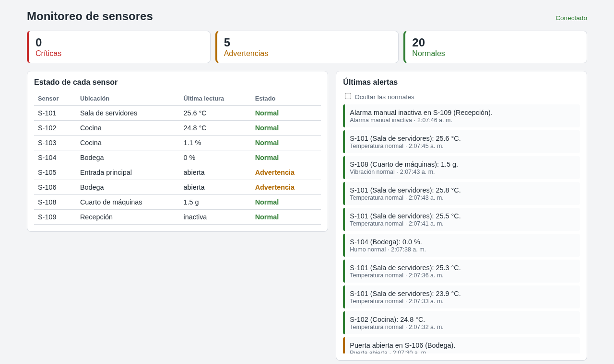

# rabbitmq-monitoreo-sensores

[](https://github.com/Whiteherobot/rabbitmq-monitoreo-sensores/actions/workflows/ci.yml)

Monitoreo de sensores de un edificio en tiempo real, armado con tres mecanismos
de comunicación: una cola de mensajes (RabbitMQ), HTTP y WebSocket. Práctica de
Sistemas Distribuidos (noviembre de 2025).



```
sensor_producer.py ──AMQP──> RabbitMQ ──AMQP──> alert_processor.py ──HTTP POST──> ws_server.js ──WebSocket──> operadores
   (Python)              cola sensores_mon          (Python)                       (Node.js)          (navegador)
```

- **Productor**: nueve sensores simulados (temperatura, humo, vibración,
  puertas, movimiento y alarma manual), cada uno con su ubicación. Las lecturas
  cambian de a poco y se publican como mensajes persistentes.
- **Procesador**: consume la cola, clasifica cada evento en verde, amarillo o
  rojo (`alertas.py`) y manda la alerta al servidor WebSocket. Solo confirma el
  mensaje si el envío salió bien; si no, vuelve a la cola.
- **Servidor WebSocket**: difunde cada alerta a los operadores conectados,
  guarda las últimas 50 para quien se conecta tarde y sirve la pantalla del
  operador.

| Sensor | Amarillo desde | Rojo desde |
|---|---|---|
| Temperatura | 35 °C | 45 °C |
| Humo | 20 % | 60 % |
| Vibración | 3 g | 7 g |
| Puerta / movimiento | abierta / detectado | |
| Alarma manual | | activada |

## Levantar

```bash
docker compose up --build
```

- Pantalla del operador: http://localhost:9000 (también desde otros equipos de
  la red, con la IP de esta máquina).
- Panel de RabbitMQ: http://localhost:15672 (usuario y clave `guest`).

Si algún puerto está ocupado: `WS_PORT=9310 RABBIT_PORT=56720 RABBIT_UI_PORT=15673 docker compose up --build`.

Sin Docker, con RabbitMQ corriendo en `localhost`:

```bash
npm install && npm start                       # servidor WebSocket
pip install -r requirements.txt
python alert_processor.py                      # en otra terminal
python sensor_producer.py                      # en otra terminal
```

## Pruebas

```bash
pytest                # sensores y clasificación de alertas
npm test              # servidor WebSocket (difusión, historial, validación)
scripts/probar.sh     # con el compose levantado: las alertas llegan de punta a punta
```

## De dónde sale

En la práctica funcionaban las piezas por separado, pero el compose solo
levantaba RabbitMQ, las direcciones estaban fijas en `localhost`, el
procesador confirmaba los mensajes aunque no hubiera podido entregar la
alerta y faltaba la pantalla que mostrara las alertas. Además cada evento
inventaba un sensor nuevo con un valor al azar, `node_modules` estaba en el
repo y había una dependencia instalada por error (`we`). En 2026 se corrigió
todo eso y se agregaron pruebas y CI. El repo se llamaba
`MecanismosDeComunicacion`.

Licencia MIT.
